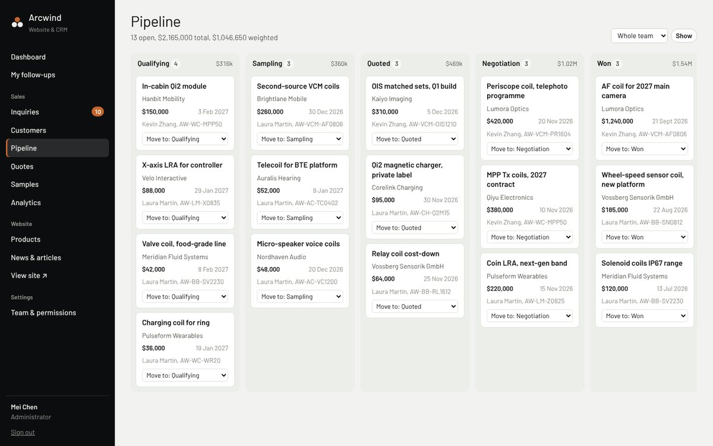
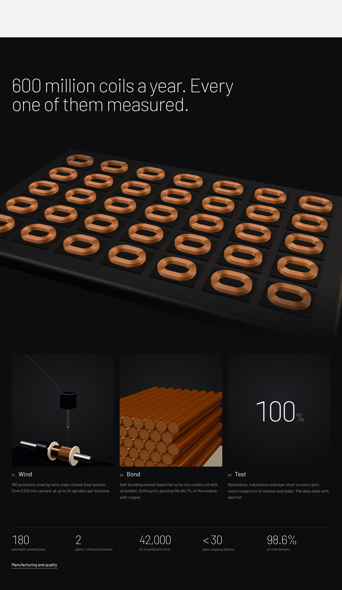

# Arcwind: precision coil manufacturer website + CMS/CRM

A bilingual (English / 简体中文) B2B website for a precision coil manufacturer, with a built-in content management system and a sales CRM in one Next.js app. The manufacturer makes VCM coils (≈10% of global shipments), air-core coils, bobbin coils, wireless charging coils, linear motors and wireless chargers.

> **Arcwind is a placeholder brand.** The company name, figures, certifications, part numbers, customers and contacts are illustrative. Replace them in `lib/site.ts` and the seed files before using this for a real client.

**Live preview (public website, static copy):** https://hunterlinhk.github.io/precision-coil-website-crm/
**Full app with CRM/CMS, one click:** [Open in GitHub Codespaces](https://codespaces.new/hunterlinhk/precision-coil-website-crm) and sign in at `/HunterLin` (username `HunterLin`, password `arcwind-demo`).


## What's inside

### Public website (`/en`, `/zh`)

| Page | What it does |
|---|---|
| **Home** | An animated orthocyclic winding cross-section. Turns are laid layer by layer, then every tenth turn lights up to show the ≈10% VCM share. Followed by product families, the drawing-to-production path, applications, recent articles and a supplier-assessment band. |
| **Products** | Parametric finder: filter by outline, height, wire diameter and resistance, sort by column, and add parts to a **quote list**. |
| **Product detail** | Generated dimensioned drawing (third-angle, title block), spec table, customization options, buyer FAQ, documents, related articles. Includes a **printable datasheet** (print or save as PDF). |
| **Applications** | Seven industries, each with what matters there, how it's handled, and parts to start from. |
| **Engineering** | Capability envelope (wire, outline and turns ranges), OEM / ODM / platform models, development timeline. |
| **Manufacturing** | Written for supplier-qualification teams: facts, plants, equipment, quality system, 12-month metrics, certifications. |
| **Resources** | Technical notes, case studies and news. |
| **Request a quote** | Quote, sample, drawing review or general question. Includes the quote list with quantities, drag-and-drop drawing upload (kept private), and an NDA option. |

**SEO / GEO (AI search) built in:** canonical + `hreflang` on every page, `sitemap.xml` with language alternates, `robots.txt`, JSON-LD (Organization, Product with spec properties, FAQPage, BreadcrumbList, TechArticle / NewsArticle), plain "key facts" blocks, and an [`llms.txt`](https://llmstxt.org) summary that AI assistants can read and cite.

### Admin (`/HunterLin`)


**CRM**
- **Inquiries inbox:** every form submission is captured automatically with its channel (Google, *AI search*, LinkedIn, Baidu, email campaign…), referrer, landing page, files and quote-list items.
- **Auto-routing:** inquiries are assigned to the rep whose regions include the buyer's country, linked to an existing customer by email domain, and given a follow-up task due within one working day.
- **First-response tracking**, with SLA highlighting.
- **Convert** an inquiry into customer + contact + opportunity (and a sample request) in one step.
- **Customers** with contacts, communication history (calls, emails, meetings, notes), follow-up reminders, quotes, samples and linked inquiries.
- **Pipeline** board (qualifying → sampling → quoted → negotiation → won/lost) with weighted value.
- **Quotes** with an editable line-item table, printable quotation document, and status that moves the deal forward when it's sent.
- **Samples** tracked from request to production, shipment (courier/tracking) and customer feedback.
- **Analytics:** inquiries per week, conversion funnel, lead sources with conversion rate and pipeline created per channel, top countries, most requested parts, response time by owner.

**CMS**
- Products and articles edited side by side in English and Chinese, with draft → preview → publish, unpublish, and delete.
- Spec-table editor, PDF datasheets, parametric filter values, drawing geometry, application tags.
- **Product photos:** upload (drag and drop), reorder, make any photo the main one, replace a photo in place, or remove it. The main photo replaces the studio render everywhere on the site (catalogue, product page, related products); with several photos the product page shows thumbnails to switch between them. With no photos, the render is used.
- Search-result preview with title/description length guidance per language.

**Permissions**

| Role | Can do |
|---|---|
| Administrator | Everything, including users and roles |
| Sales manager | All CRM records, assigns inquiries, edits website content |
| Sales rep | Own customers and deals plus unassigned inquiries; receives inquiries from their regions |
| Content editor | Products and articles only, no customer data |

<p>
  
  
</p>

## Design notes

**Direction: "Magnified".** The company's story has two scales: wire six times finer than a hair, and hundreds of millions of parts a year. The site shows both. Studio-lit product shots and a macro view of the turns carry the precision; a production tray, the winding head and a cut-away cross-section carry the volume and the process.

- **The product is the imagery.** Every product, and every manufacturing scene, is a physically based 3D render of the real part geometry (enamelled copper, litz wire, ferrite, brushed steel, polyimide), lit in a virtual softbox studio. Uploaded photography replaces a render automatically when a product has photos in the CMS.
- **Monochrome interface, copper product.** Neutral studio paper (`#f2f2f0`), a darker sweep (`#e6e6e2`) for product stages, true black type, and a dark studio (`#0c0d0e`) for the macro and manufacturing sections. The only colour on the page comes from the products themselves.
- **Type.** Barlow, a DIN-lineage grotesk: the same family of lettering used on engineering drawings and industrial signage. Hairline 200 weight for display (a nod to fine wire), DIN numerals for specifications. Chinese falls back to PingFang SC / Noto Sans SC.
- **Rhythm.** Light and dark sections alternate. Each screen makes one statement. Measurement conventions (dimension lines, specimen captions, a to-scale hair/wire comparison, a development timeline drawn in weeks) are the graphic language.
- **Interaction.** Product pages have Photo / 3D / Drawing views. The 3D view loads only when opened, and is drag-to-rotate and scroll-to-zoom. The catalogue switches between an image grid and a sortable table, with parametric filters.
- **Tones.** The renders are transparent, so every product family and industry sits on its own muted backdrop (clay, fog, sand, sage, graphite, lilac, steel, mint). The catalogue reads by colour at a glance; the products stay true to life.

### Motion and interaction

All motion is CSS and small, dependency-free client components (`components/site/motion.tsx`, `app/flair.css`), driven by `data-*` attributes so server components stay server components. Everything switches off under `prefers-reduced-motion`, and content is fully visible without JavaScript.

| Where | What it does |
|---|---|
| Hero | Headline rises word by word, "One in ten" in moving copper; a **magnifying loupe** follows the cursor over the coil; a live counter of coils wound today (600M/yr ≈ 19 per second); a rotating seal |
| Macro | Figure counts down from 1.000 to 0.012 mm, image zooms with scroll, a **measuring reticle** reads out X/Y in mm under the cursor, hair ring draws itself |
| Manufacturing | A **vision-inspection scan** sweeps the production tray and each coil it passes reports PASS with its resistance; facts count up; a dot-matrix map with a shuttle between the two plants |
| Timeline | Gantt bars grow in sequence on graph paper |
| Exploded view | Callouts pop in one by one; hovering a layer highlights its callout |
| Applications | Home: a floating preview follows the cursor down the list. Index: a **scroll story**, the sticky stage changes colour and product per industry |
| Product pages | Loupe on the photo, dimensioned drawing draws itself, key figures count up; adding to the quote list sends a copper bead to the header counter |
| Quote form | Five turns of wire fill in copper as the required answers are completed; confirmation bursts |
| Everywhere | Scroll-progress copper line under the header, magnetic buttons, spotlight cards, marquee of families, wire that winds itself on scroll at the end of the page, footer wordmark lit by the cursor, local time at the Dongguan plant |

<p>
  
  
</p>
<p>
  
  
</p>
<p>
  
  
</p>
<p>
  
  
</p>

### Product renders

The images in `public/renders/` are generated from code, not photographed:

```bash
npm run render                       # all shots (needs Playwright's Chromium)
node scripts/render/run.mjs aw-vcm-af0806 && node scripts/render/reframe.mjs   # one shot
```

- `lib/coil3d/models.ts`: procedural models for every product type, in millimetres, driven by each product's `dims`. Modelled on the manufacturer's real parts: autofocus coils wound on octagonal lens carriers, AF + OIS carriers with flat drive coils, receiver coils on nanocrystalline sheet, two- and three-coil transmitters on ferrite with Kapton-taped leads, SMD linear-motor drive coils, and bonded copper air-core coils
- `lib/coil3d/studio.ts`: softbox environment, key light, contact shadow and framing
- `lib/coil3d/scenes.ts`: the product and manufacturing shots
- `scripts/render/reframe.mjs`: crops every studio render to the same visual scale

The same models drive the live 3D viewer on product pages, so a product added in the CMS with a known shape gets a 3D view immediately.

## Tech

- Next.js 15 (App Router, Server Actions), React 19, TypeScript
- Three.js for the product renders and the 3D viewer
- SQLite via `better-sqlite3`: one file, no database server to run
- No UI framework; hand-written CSS, self-hosted Barlow
- Auth: scrypt password hashes and HTTP-only session cookies
- Uploads are stored on disk. Customer drawings are private and only downloadable by signed-in CRM users.

## Getting started

```bash
npm install
npm run dev            # http://localhost:3000  →  /en, /zh, /HunterLin
```

The database (`data/arcwind.db`) is created and filled with demo content on first start. To start over: `npm run seed` (deletes the database; it is re-seeded on next start).

The admin lives at **`/HunterLin`** (any capitalisation redirects there). Sign in with a username or a work email.

**Demo accounts** (password `arcwind-demo`, or whatever you set in `ADMIN_PASSWORD` before first start):

| Sign in as | Role |
|---|---|
| `HunterLin` (or admin@arcwind.example) | Administrator |
| daniel.wu@arcwind.example | Sales manager |
| kevin.zhang@arcwind.example | Sales rep (CN, TW, HK, KR, JP) |
| laura.martin@arcwind.example | Sales rep (Americas & Europe) |
| anh.nguyen@arcwind.example | Sales rep (South & Southeast Asia, AU) |
| grace.liu@arcwind.example | Content editor |

## Configuration

| Variable | Default | Purpose |
|---|---|---|
| `SITE_URL` | `https://www.arcwind.example` | Absolute URLs in canonical tags, sitemap, JSON-LD, llms.txt |
| `ADMIN_PASSWORD` | `arcwind-demo` | Password for the seeded accounts (only read when the database is first created) |
| `DATA_DIR` | `./data` | Where the SQLite file and uploads live |
| `INSECURE_COOKIES` | unset | Set to `1` to allow sign-in over plain HTTP in production (local testing only) |

## Deploying on your own server

```bash
npm ci
SITE_URL=https://www.example.com ADMIN_PASSWORD='change-me-now' npm run build
SITE_URL=https://www.example.com npm start -- -p 3000
```

Put it behind nginx or Caddy with HTTPS (session cookies are `Secure` in production), and keep it running with a process manager such as pm2 or systemd. **Back up the `data/` directory**: it holds the database and all uploads. Change every demo password from *Team & permissions* after the first sign-in.

## Static preview (GitHub Pages)

The public website can also be exported as a static, read-only copy:

```bash
NEXT_PUBLIC_BASE_PATH=/precision-coil-website-crm SITE_URL=https://hunterlinhk.github.io/precision-coil-website-crm npm run preview:static
```

This builds with the base path, crawls every page in both languages into `preview-out/`, and puts the quote form in preview mode (it shows the confirmation without sending anything). That folder is what the `gh-pages` branch serves. The CRM/CMS needs the Node server and database, so it is not part of the static copy; use Codespaces or your own server for that.

## Making it a real client's site

1. `lib/site.ts`: name, contacts, address, plants, headline figures, certifications.
2. `lib/catalog-seed.ts`, `lib/articles-seed.ts`, `lib/applications.ts`: starting catalogue, articles and industries (or delete the seed data and add content from the admin).
3. `lib/i18n.ts`: all interface copy in both languages.
4. `public/icon.svg` and the `BrandMark` component: the logo.

## Project structure

```
app/
  [locale]/            public site (en, zh)
  HunterLin/(auth)/login   sign-in (username or email)
  HunterLin/(app)/…        CRM + CMS screens
  HunterLin/actions.ts     all server actions (permission-checked)
  api/inquiry          form capture → CRM
  api/media, api/files public media / private customer files
  sitemap.ts, robots.ts, llms.txt
components/site        header, footer, product stage, 3D viewer, drawings, finder, inquiry form
lib/coil3d             3D models, studio lighting and scenes for renders and the viewer
scripts/render         headless render pipeline → public/renders/*.webp
components/admin       shell, tables, charts, editors
lib/                   db + schema, seed data, auth, i18n, SEO helpers, CRM rules
```

## License

MIT
